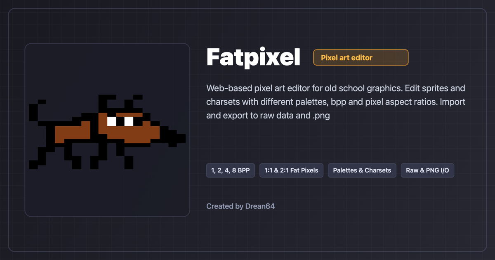

# FatPixel

A lightweight, browser-based pixel art editor for old school graphics.

Use the app online: [https://ernestoborio.github.io/pixel/](https://ernestoborio.github.io/pixel/)



## Features

- **Pixel bit depth**: 1, 2, 3, 4 and 8 bits per pixel.
- **Pixel aspect ratio**: 1:1 and 2:1 (_fat pixels_).
- **Palettes**: 2, 4, 8, 16, 32, 64, 128 and 256 colors.
- **Built-in palettes**: C64 Pepto, Drean 64, ZX Spectrum 16, VGA 256, etc.
- **Drawing Tools**: Pencil, Line, Rectangle, Ellipse, Flood Fill, Eyedropper, Shift, Rotate, and Mirror.
- **Project Files & Export**: Git-friendly format `.pxp` JSON based, PNG export, and CSV binary tables.
- **Undo / Redo**: Multi-level snapshot history.

## Getting Started

```bash
# Install dependencies
npm install

# Start local development server
npm run dev

# Run unit tests
npm test

# Build for production
npm run build
```

## License

This project is licensed under the [GNU General Public License v3.0](LICENSE).
